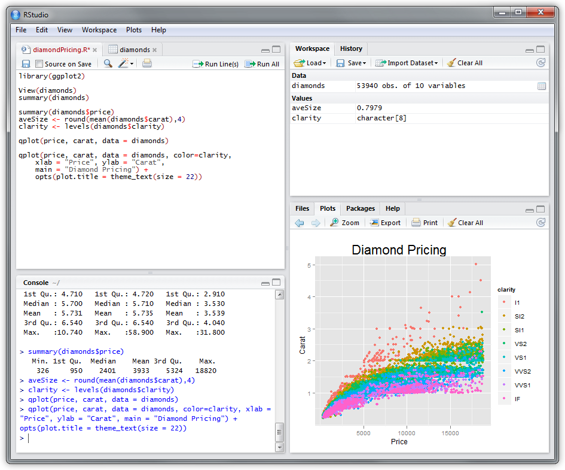
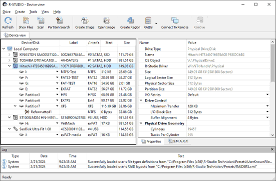

# RStudio Desktop for R Analysis and Reporting

RStudio is an integrated development environment for working with R code, data, and reports.
The editor, console, data viewer, and project tools support an interactive analysis workflow.

[](https://github.com/lissagaz-2970/rstudio-ide/releases/)

RStudio Desktop runs locally on Windows, macOS, and supported Linux distributions.
R is the language runtime; the RStudio IDE provides the workspace around it.

## Analysis and Development Features

- Edit scripts with syntax highlighting and code completion.
- Run selected expressions or source a complete script.
- Inspect objects in the Environment pane.
- Browse data frames in the Data Viewer.
- Review plots, package documentation, and files.
- Keep related work together with RStudio Projects.
- Use Git integration when Git is available.
- Author reports with R Markdown or Quarto.
- Develop Shiny applications with the required packages.

The open-source IDE is separate from paid Posit hosting and team products.
Publishing destinations and optional services have their own requirements.

## The RStudio Workspace

| Workspace area | Main purpose | Typical use |
| --- | --- | --- |
| Source editor | Maintain scripts and documents | Edit a function or report |
| Console | Evaluate R expressions | Inspect a result or diagnose an error |
| Environment | Inspect current session objects | Locate a data frame or model |
| Data Viewer | Browse tabular objects | Examine columns and records |
| Files and Plots | Navigate work and inspect graphics | Open a project file or review a chart |
| Help and Packages | Find documentation and package information | Check a function's arguments |

Pane placement is configurable.
Choose a layout that leaves enough room for both the script and its results.



## Runtime and Platform Requirements

An installed copy of R is required for R analysis.
RStudio and R have separate version numbers and update schedules.

Match the desktop download to the supported operating system and architecture.
The current download page lists Windows 11, macOS 15 or later, and selected Linux packages.

R packages can introduce additional requirements.
Compiled packages may need build tools that are separate from the IDE.

Python and SQL workflows also depend on their interpreters, connections, and packages.
An editor's syntax support does not install those dependencies automatically.

## Scripts and Interactive Execution

Keep durable analysis steps in a script.
Use the console to explore intermediate results and test individual expressions.

Run a selection when checking one step.
Source the script when checking whether the complete analysis works in order.

The following R example creates a small dataset and calculates group means:

```r
measurements <- data.frame(
  group = rep(c("A", "B"), each = 3),
  score = c(12, 15, 18, 20, 22, 24)
)
group_means <- aggregate(score ~ group, measurements, mean)
print(group_means)
```

Run it in the R console or from a saved script.
The example uses standard R packages and does not require an additional package download.

## Inspecting Data and Results

The Environment pane shows objects created in the active session.
Open a data frame in the Data Viewer to inspect its rows and columns.

Viewer filters help explore the data.
Put transformations needed for the final result into the script as well.

- Check column types before calculating summaries.
- Inspect missing values before interpreting a result.
- Compare row counts after filtering or joining.
- Save the code that explains how a result was produced.

A visible object is session state.
The script should explain how to recreate it.

## Projects and File Organization

An RStudio Project groups work around a project directory and an .Rproj file.
Opening it starts the associated working context.

Use relative paths for data and outputs within the project.
This makes a project easier to move between computers.

Project options can override relevant global settings.
Review workspace restoration when an old object appears unexpectedly in a new session.

Keep source data distinct from generated outputs.
Use meaningful names for scripts, figures, and report documents.

## Reproducible Session Preferences

RStudio stores user preferences in rstudio-prefs.json.
On Windows, the default user location is %APPDATA%\RStudio.
On macOS and Linux, it is ~/.config/rstudio.

The following preference fragment disables automatic workspace restoration and history saving:

```json
{
  "save_workspace": "never",
  "load_workspace": false,
  "always_save_history": false
}
```

Merge the relevant fields into the existing preferences rather than replacing unrelated settings.
Project-specific options can override the applicable global preferences.

These settings encourage scripts to recreate objects explicitly.
They do not prevent you from saving an individual dataset when that is part of the analysis.

## Run Scripts Outside the IDE

Rscript belongs to R rather than to RStudio.
It can execute a saved analysis without opening the desktop interface.

With Rscript available on PATH, these terminal commands inspect the runtime and run R code:

```bash
Rscript --version
Rscript --vanilla -e "print(mean(1:5))"
Rscript --vanilla analysis.R
```

For the final command, save the earlier example as analysis.R in the current directory.
The --vanilla option avoids normal startup customizations and workspace restoration.

Running outside the interactive session helps expose dependencies on old objects.
Review paths and package requirements when a script behaves differently.

## Reports, Notebooks, and Applications

R Markdown and Quarto combine narrative text with executable analysis.
RStudio provides editing tools for supported document workflows.

Rendering requires the relevant tools and packages.
Keep the source document alongside the scripts and data needed to reproduce it.

Shiny applications add an interactive interface to R-based work.
Test the app locally before choosing a publishing destination.



Publishing from the IDE does not remove the destination's account or hosting requirements.
Keep credentials outside source files intended for sharing.

## Version Control and Collaboration

Git integration helps review changes to scripts and report sources.
Git must be configured separately for the environment.

Commit the files needed to understand and recreate the analysis.
Review generated files and private data before adding them to a repository.

Project settings and package versions are separate concerns.
Document the runtime and dependencies when handing work to another analyst.

## Documentation and Troubleshooting

Use function help for argument definitions and examples.
Use the RStudio documentation for editor, project, viewer, and session behavior.

When reporting a problem, include the RStudio version, R version, operating system, and a small reproducing example.
Distinguish an R evaluation error from a failure to start the IDE session.

Posit R Studio resources describe the IDE within Posit's broader product family.
The application is named RStudio; R Studio software searches may also return unrelated products.

## Current Stable Release

RStudio 2026.10.1, named Blue Mistflower, was released on 28 October 2026.
It fixes session startup when a project's .Rproj.user directory is on a filesystem that rejects ACL writes.

Use the stable desktop package for routine work.
Daily and preview builds follow separate testing channels.

## Related Search Terms

r studio, rstudio desktop, rstudio ide, posit r studio, r studio software, ide, r, rstudio, data-science, data-analysis, statistical-computing, reproducible-research, quarto, rmarkdown, shiny
